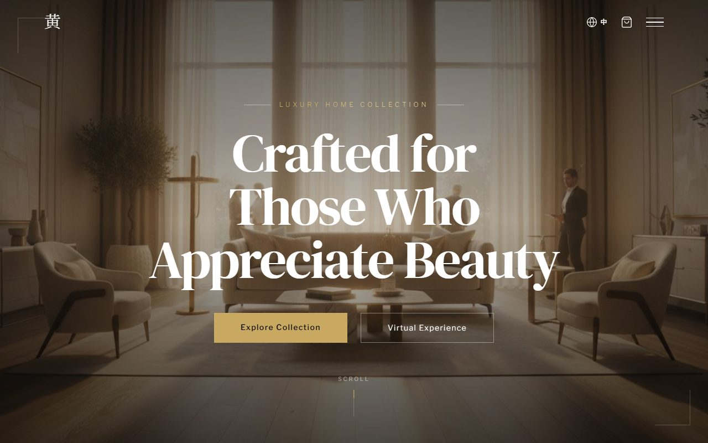
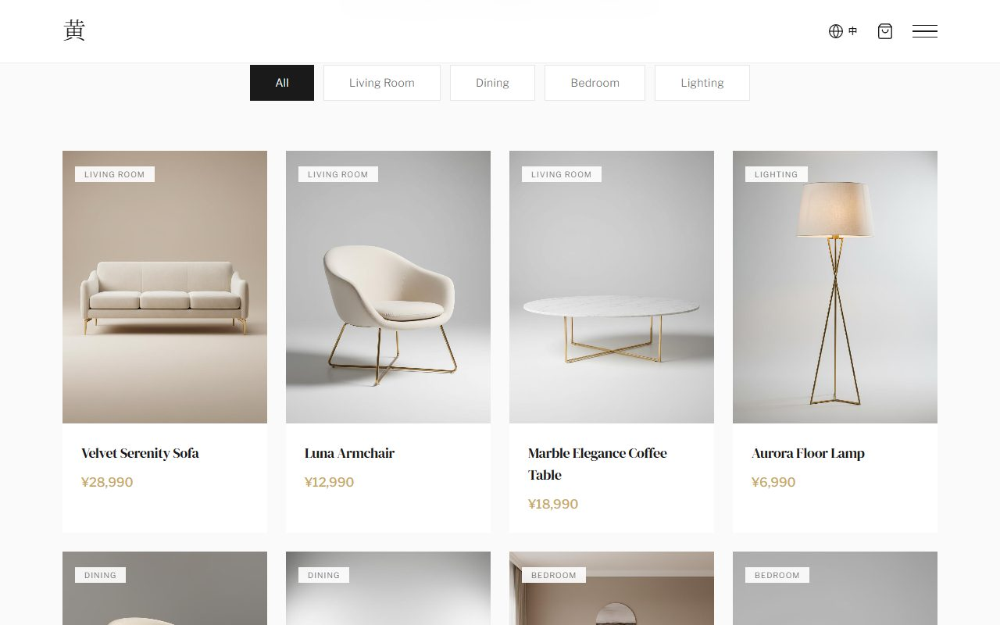

# Huang Furniture

A website for a luxury furniture shop, in Chinese and English, with scroll-driven animation.

**[Open the live site](https://cheepheng.github.io/huang-furniture/)**

## What's on the site

- **Chinese and English.** The globe button in the header switches the whole site between 中文 and English.
- **A scroll-driven hero.** Four full-screen scenes play as you scroll, animated with GSAP ScrollTrigger.
- **A product catalogue** with room filters (living room, dining, bedroom, lighting), prices and add-to-cart buttons.
- **Brand story, blog, FAQ and newsletter sections.** The FAQ covers delivery times, custom orders, returns, interior design and furniture care.
- **Tuned for speed and access:** lazy-loaded images below the fold, meta and Open Graph tags for search and sharing, a sitemap, and a skip-to-content link for keyboard users.

## Built with

React, GSAP (ScrollTrigger) and Vite. This repository holds the production build that GitHub Pages serves.
